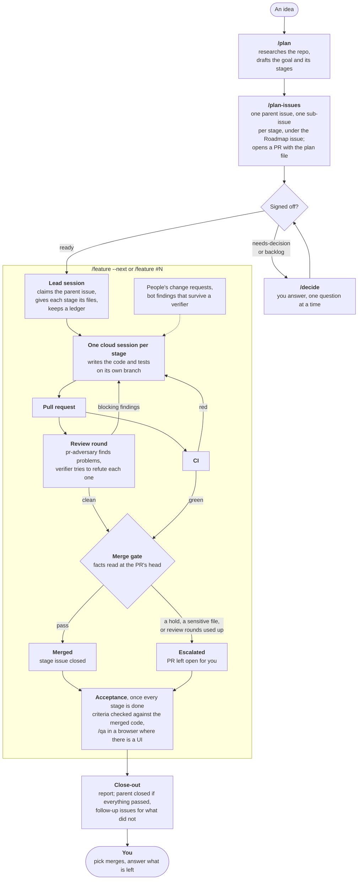

# ai

Shared Claude Code skills, gathered from working across different projects so
they live in one place instead of being copied between them.

## How it works

An idea becomes merged code in five steps. You decide what to build and answer the questions only you can; agents do the rest, and anything they cannot settle comes back to you.



1. **Plan.** `/plan` researches the repo, then turns your request into a plan file: the goal, the stages (each one PR), and how each stage is checked. With `--explore` it narrows the request down with you before drafting.
2. **File.** In a repo that tracks plans as issues, `/plan` finishes by asking you the plan's open decisions, then runs `/plan-issues`. That files one parent issue and one sub-issue per stage, queues the parent under the Roadmap issue, and opens a PR with the plan file for you to merge. The parent is labelled `ready` once you sign it off; a plan or stage with open questions is `needs-decision`, and one you have not signed off yet is backlog. `/decide` works through both later.
3. **Build.** `/feature --next` picks up the next `ready` parent (`/feature #N` builds a chosen one, asking for sign-off first if it needs it). A lead session gives each stage the files it owns and the acceptance criteria to meet, then starts one cloud session per stage. Each writes its stage on its own branch and opens a pull request. (`/pickup` lets one session, or a person, work a single stage by hand instead.)
4. **Review and merge.** A PR gets a review round when it opens and again after each push that answers blocking findings, up to three rounds. Fresh agents run each round: one finds problems, another tries to disprove each one, and only what survives goes back to the author. A person's change request goes back to the author too; a person's question or hold stops the merge and comes to you; a review bot's comment is checked by a verifier first. A PR merges only when the review is clean, CI is green, nobody has an open request or hold, it stayed inside its stage's files, the stages it depends on have merged, and GitHub says it can merge. A PR that touches CI, dependencies, security code or the agents' own files waits for you instead, as does one still failing after its last round.
5. **Accept and report.** Once every stage has merged or escalated, the result is checked against the acceptance criteria: by reading the merged code, and by running it in a browser with `/qa` when there is something to drive. A clean run closes the parent issue. Anything unmet or escalated leaves it open, with a follow-up issue and a list of what needs you.

## Using them

Three ways, depending on where the session runs.

**As a plugin (local CLI, desktop and IDE sessions).** This repo is a plugin marketplace (`.claude-plugin/marketplace.json`, named `amritk`) holding one plugin, `ai`, whose manifest (`.claude-plugin/plugin.json`) points at `.claude/skills/` and `.claude/agents/`, so nothing moves:

```
/plugin marketplace add amritk/ai
/plugin install ai@amritk
```

A repo can offer it to everyone who opens it by listing it in its `.claude/settings.json`:

```json
{
  "extraKnownMarketplaces": { "amritk": { "source": { "source": "github", "repo": "amritk/ai" } } },
  "enabledPlugins": { "ai@amritk": true }
}
```

Plugin skills and agents are namespaced (`/ai:feature`, `ai:checker`). Updates arrive only when you run `/plugin` → update, unless you turn on the marketplace's auto-update. Pin a `ref` or `sha` on the marketplace source to make them deliberate.

**Copied into a repo (Claude Code on the web and other cloud sessions).** A cloud session loads none of the plugins a repo's settings turn on. It only loads what is committed under the repo's own `.claude/skills/` and `.claude/agents/`. A repo whose agents run in the cloud, as `feature` runs do, commits copies of the skills it uses, pinned to a commit of this repo, with a script that refreshes them and fails on a hand edit. `amritk/nish`'s `scripts/sync-skills.mjs` is one. Fix a skill here, then sync, never in the copy.

**Linked into a session.** Claude Code loads a linked repo's `.claude/skills/`, so linking this repo next to the one you work on makes everything below available as `/<skill-name>`, with no install step.

The layout is the same for all three:

```
.claude/skills/<name>/SKILL.md    # one directory per skill
.claude/agents/<name>.md          # subagents the workflow skills fan out to
.claude-plugin/                   # the marketplace and plugin manifests
```

### Watch for name collisions

Several of these skills may also exist in the repo they came from. Link this
repo next to one that carries its own `check`, `plan`, `typescript`, or `tests`
skill and you have two of each. Only one copy of a given name wins, and which
one is not worth guessing at.

So this is most useful linked next to a repo that does *not* already carry
these. To get the clean version everywhere, the duplicates eventually have to
come out of the source repos; nothing here requires that first.

### There is deliberately no CLAUDE.md

A linked repo's `CLAUDE.md` loads too, and this one has no business telling
another repo how to build. Keeping it absent means linking this repo adds
skills and nothing else.

## Skills

**Workflow**

| Skill | What it does |
| --- | --- |
| `check` | Reviews the branch's diff against main adversarially, inline when it is one shard and fanned out to read-only `checker` subagents when it is larger, then reduces the findings to a plan. |
| `check-iterate` | Runs that as a loop — `checker` collects, `verifier` refutes, the primary agent fixes and pins each fix with a regression test — until a pass comes back clean or three loops (four when the last one was still finding less). Lint and types run before any reviewer, and later loops review only what the last loop's fixes changed. |
| `plan` | Writes plan files in the `.claude/plans/<slug>.plan.md` stages schema, researching the request in the repo first; with `--explore`, it also narrows the request down with you before drafting. In a repo with an open `roadmap` issue, it settles the plan's decisions, queue position and sign-off with you, then files it `ready` with `plan-issues` and opens a PR with the plan file, which it leaves for you or `pr-land` to merge. |
| `plan-execute` | Executes a plan file, runs the plan's own verification commands, drives the check loop over the result, then publishes the run through `session-report`. |
| `feature` | Takes requirements to merged PRs on Claude Code cloud — plans the work, gives each stage its own cloud session, branch, and PR, reviews each PR with fresh-context adversarial rounds (three, plus one while blocking findings are still going down; later rounds review only what the worker changed since), and merges when the gate passes. A PR still failing after that is escalated to you, never merged. Stops once, for plan acceptance — or, in issue mode (`/feature #N`, `/feature --next`), builds a parent issue whose sub-issues are its stages, taking the parent's `ready` label as the sign-off and closing the issues as the PRs merge. |
| `plan-issues` | Files plan files as GitHub issues: one parent per plan, one sub-issue per open stage, existing issues reused rather than duplicated, every parent ordered under one Roadmap issue, and the issue numbers recorded back into the plans. Idempotent. |
| `pickup` | How one agent picks up, works, hands off or takes over one issue in a repo that tracks plans as issues: the labels, which issue to take, the claim and its one status comment, when to push, `Fixes` lines, asking the owner, stopping, and the 24-hour takeover rule. `feature`, `plan-issues` and `decide` all defer to it. |
| `decide` | Gathers every issue labelled `needs-decision`, then every plan awaiting sign-off, in one pass, asks the owner each one as a selection prompt with options and a recommendation, records the answer on the issue, and relabels it so agents can build it. `--watch` makes the session the standing place those questions arrive: it registers itself on the Roadmap issue, agents message it the moment they ask, and an hourly check catches anything a message missed. The agent that asked also asks in its own session, so you can answer there or in `/decide`; whichever you answer first is recorded, the other place is told, and you are not asked twice. |
| `session-report` | Publishes what the session did as a linked Claude artifact: what was asked, what changed, what was verified, every finding with its verdict and fix, and what needs a human. Leaves the link on the PR when there is one. |
| `pr-review` | Reviews one PR (or the current branch, with `--branch`) against a prompt you supply. Posts line-anchored comments, capped at a `COMMENT` review. |
| `pr-triage` | Reads the whole open PR queue and publishes one page rating every PR Low → Critical, with a "start here" list. |
| `async-daily` | Writes an async standup grouped by pull request — what merged, what is still open, plus local work that is not a PR yet. Covers every repo you touched, not just the ones checked out. |
| `debug` | Reproduce, localise, hypothesise, fix, prove: root-causes a bug or flaky test and leaves a regression test behind. `--no-fix` stops at the diagnosis. |
| `pr-land` | Drives one PR (or a short list) to merged: optional review through `pr-review`, then watches it, fixes red CI, conflicts and reviewers' change requests on branches you own, and merges on green at the exact head it verified. The per-PR half of `feature`, for work that was not planned as a run. |
| `pr-merge` | Ships this session's work with no arguments: commits and pushes the branch, opens a PR (or reuses the open one), then runs `pr-land --review --archive` to review it, fix red CI and conflicts, merge, and archive the session. `--no-review` skips the review; `--keep` keeps the session. |
| `perf` | Makes something measurably faster or shows it cannot be: names the metric and the hardware the result is judged on, takes an interleaved baseline with a noise band, profiles before changing code, checks output against the baseline, and ends in a PR or a "no change, here is the data" page. |
| `qa` | Runs a QA pass on a feature in a real browser — Claude in Chrome where the session has it, a Playwright fallback where it does not — reproduces every failure before reporting it, and publishes a report with a verdict, findings, evidence, and what was not covered. |

`check`, `check-iterate`, and `plan-execute` stage their work; none of them commit.
`debug` edits but never stages or commits. `async-daily`, `session-report`, and `qa` are read-only in the repo; `session-report` publishes an artifact and may comment its link on the branch's PR, and `qa` publishes one too. `qa` is the only skill here that touches something outside the repo — a running app — so it confirms the target with you before it starts and refuses destructive checks against production.
`perf` edits and may open a PR for a measured win. `pr-land` pushes fixes only to a
branch you own or asked it to drive, and merges only the PRs you named — asking it is
the approval.
`pr-merge` commits, pushes, and opens a PR for this session's branch, then hands it to `pr-land`;
typing it is the approval to merge that PR and archive the session.
`plan-issues` writes issues and the plan files' `issue:` fields, then commits the plan files and opens a PR for them that it never merges. It never closes or rewrites an existing issue. `decide` only comments and relabels, and only on an answer the owner picked.
`feature` is the exception to all of it — it plans, commits, pushes, opens PRs, and merges
them on its own, which is why it stops for an explicit human approval of the plan
before it does anything.

**Agents**

| Agent | Role |
| --- | --- |
| `checker` | Read-only collector. Assumes the branch's diff is broken and hunts for evidence: a concrete input, a caller that did not adapt, a test that would still pass if the code were wrong. Grounds itself in the repo's own agent guidance first, read at the diff base so the branch cannot rewrite its own rules, so a settled convention is never a finding. |
| `pr-adversary` | Read-only reviewer for one `feature` review round. Same mandate as `checker`, but it reads a pull request's diff through the GitHub API at a fixed head SHA rather than a local checkout, and it also polices the things only a fan-out run can get wrong: files outside the slice's lane, drift from the plan, and edits that weaken the very gates the run merges on. |
| `verifier` | Read-only refuter. Takes another reviewer's findings and defaults to `REFUTED`, confirming only what it can trace itself. The two agents have opposite mandates on purpose: a finding has to survive both before anyone edits. |
| `run-reconciler` | Read-only state collector for one `feature` wake. Checks every ledger row (or just the one whose PR caused the wake) against GitHub and the worker sessions and returns only the rows that drifted; in `gate` mode it returns the merge gate's facts for one PR at its head. Either way, raw PR and CI payloads never fill the long-lived lead's context. |

All four run on Sonnet 5.5, the reviewers at medium effort and `run-reconciler` at low, since collection is wide and parallel and the judgment calls stay with the orchestrator.

**Conventions**

| Skill | What it covers |
| --- | --- |
| `typescript` | Typing, `Result`-based error handling, ESM conventions, naming, JSDoc. |
| `tests` | Vitest and Playwright practice, and running suites scoped through the repo's task runner. |
| `comments` | Why-not-what comments, JSDoc, and the global-CSS exception. |
| `vue-components` | Composition API structure, typed props and emits, Tailwind, accessibility. |
| `openapi-glossary` | Consistent OpenAPI terminology. |

## Working from issues

`plan-issues`, `feature`, `pickup` and `decide` together run a roadmap kept as GitHub issues. Each plan file in `.claude/plans/` is a parent issue labelled `plan`, and each of its stages is a sub-issue, one PR each. Every parent sits under one issue labelled `roadmap`, whose sub-issue order is the order work is picked up in. The plan file holds the spec, and the issues hold the state.

| Command | What it does |
| --- | --- |
| `/plan <what to build>` | Research the request in the repo, then write a plan from it as given. Where a `roadmap` issue exists, it also settles every open decision in the plan with you, one question at a time (with Discuss first), asks where it goes in the queue and whether agents may start it, then files it. New work goes from a description to `ready` issues in one session, with no separate `/decide` pass. |
| `/plan <what to build> --explore` | The same, but after the research it narrows the request down with you: what it found, a few questions that change the plan (each skippable), a restatement of the goal and scope to confirm, then a fresh-context review of the draft. For a direction rather than a spec. |
| `/plan-issues [plans…]` | File plans as issues, or file what is new in them. An open issue that already is a stage's work is attached as that stage instead of a duplicate being filed, and one the stage also fixes is attached under it; records each issue number back in the plan. Rerunning creates only what is missing. |
| `/plan-issues --dry-run` | Print what would be filed, and file nothing. |
| `/plan-issues --no-root` | File without creating or using a `roadmap` issue. |
| `/plan-issues --no-match` | Skip matching. By default every new stage is first matched against the repo's open issues, and an issue that is that stage's work is attached instead of a new one being filed. |
| `/feature #N` | Build parent issue N: a session and a PR per open stage, review, merge, close the issues. A parent labelled `ready` runs without stopping for sign-off. |
| `/feature --next` | Claim the first `ready` parent under the `roadmap` issue and build it. First archives the lead sessions of earlier `--next` runs that finished cleanly (tracking issue closed, session idle), once each; escalated runs keep theirs. |
| `/feature --next --max-runs N` | The same, unless N parents are already `in-progress` (default 5). Fit for a recurring scheduled task. |
| `/feature --status <slug>` | Report a run from its tracking issue; change nothing. |
| `/feature --abort <slug>` | Stop a run; keep its branches and PRs. |
| `/pickup #N` | Work one stage by hand: claim it (the `in-progress` label, you as assignee, and you added to the parent's assignees), keep its status comment current, push at checkpoints, and close it with the PR's `Fixes` line. |
| `/pickup next` | The same, for the first buildable stage of the first `ready` parent. |
| `/decide` | Ask the owner every `needs-decision` question, one at a time: background in chat, then the question with its options plus **Discuss first** and **Skip for now**. Records each answer on its issue and relabels it (skipping any you already answered in the asking session, and messaging that session when you answer here), then goes straight on to offer each unlabelled plan for sign-off as `ready`. |
| `/decide --batch` | Up to four questions per prompt with no discussion, for clearing simple items quickly. |
| `/decide #N …` | Only those issues. |
| `/decide --no-backlog` | Stop after the `needs-decision` questions, without the backlog sign-off. |
| `/decide --watch` | Make this session the decisions session: it registers on the `roadmap` issue, agents message it when they ask, and an hourly check catches the rest. |
| `/decide --unwatch` | Stop being the decisions session. |

The labels: `ready` (signed off, so agents may build it), `needs-decision` (waits on the owner), `deferred` (wanted, not scheduled), `in-progress` (claimed), `plan` (a parent issue) and `roadmap` (the ordering issue). [`pickup`](.claude/skills/pickup/SKILL.md) defines them, along with the claim, checkpoint and 24-hour takeover rules every agent follows, and the assignee rule: a stage is assigned to whoever is building it, and its parent to everyone building or who built one of its stages.

## Evals

`evals/` scores `/check` and `/check-iterate` against fixture diffs with planted
bugs and compares any two refs, so a change to a skill or agent ships because it
measured no worse, not because it read better:

```
python3 evals/run.py --skill check --ref main --ref WORKTREE
```

See [`evals/README.md`](evals/README.md) for what it grades and how to add a case.

## Tests

Every script in the repo has tests in `tests/`: the skills' bundled scripts,
`scripts/validate.py` and `evals/run.py`. They use only the standard library's
`unittest` (`plan-issues.py` itself needs PyYAML) and never call a model or the
network. CI runs them on every pull request, after the validator and the eval
fixture self-test:

```
python3 -m unittest discover -s tests -t .
```

`tests/test_every_script_is_tested.py` fails when a script has no test file that
names its path, so a new script cannot land untested.

## Where these came from

These grew out of working across different projects and out of reading how
engineering teams at other companies run their day-to-day — how they review,
plan, report status, and land changes — rather than being lifted from any one
codebase. A habit that kept paying off in more than one project became a skill;
a process described well in an article was adapted until it worked for an agent.
`typescript` and `tests` had drifted into several versions across projects — the
richest of each was kept and its project-specific commands generalised.

Repo-specific paths, package names, and task-runner commands are either removed
or stated with the condition under which they apply. `pr-review` resolves the
repository from `origin` rather than assuming one, and reads whatever agent
guidance the repo has instead of a fixed list of files.

## What is deliberately not here

Skills that only work inside one repo stay there — anything tied to a specific
layout, fixture set, or toolchain. `session-report` replaced one such
repo-specific `report` skill with a rewrite that depends only on git and the
Artifact tool, and is renamed so it never collides with the original. The bar
for adding something here is that it would work unchanged in a repo that has
never seen it.

## Adding a skill

1. `.claude/skills/<name>/SKILL.md`, with any references and scripts beside it.
2. Write the `description` for triggering — what it does *and* when to reach
   for it, in the words someone would actually use.
3. Strip repo-specific paths, package names, and commands, or state the
   condition under which they apply.
4. `python3 scripts/validate.py`.
5. A bundled script gets `tests/test_<skill>_<script>.py`, which runs it the way
   the skill does (see [Tests](#tests)).
6. If it changes how `check`, `check-iterate`, or their agents behave, run the
   eval (`evals/`) against `main` before merging.

The validator checks each skill's frontmatter `name` matches its directory, that
it has a description within Claude Code's listing limit, that every
`<skill dir>/…` pointer and relative Markdown link resolves, that no Cursor
`mdc:` links survived the move, that `allowed-tools` names the subagent tool as
`Agent` (there is no `Task` alias, so a `Task` entry pre-approves nothing), that
every `subagent_type` a skill spawns has an agent file, and that no bundled file
sits there unreferenced. Agents get the same treatment against the fields the
sub-agent docs define (`model`, `effort`, `color`), and every agent that rates
findings `high | medium | low` must carry the same severity rubric word for word —
an agent file cannot point at a shared reference, so the copies are compared instead.

## Adding an agent

1. `.claude/agents/<name>.md` with `name`, `description`, `tools`, and a model.
2. Give it one mandate and state it in the first paragraph. `checker` assumes the
   code is broken; `verifier` assumes the finding is. An agent that hedges
   between two stances does neither job well.
3. Define its output format in the file, so the skill that spawns it can parse
   the result without restating the schema in every prompt.
4. `python3 scripts/validate.py`.
5. If it changes how `check`, `check-iterate`, or their agents behave, run the
   eval (`evals/`) against `main` before merging.
